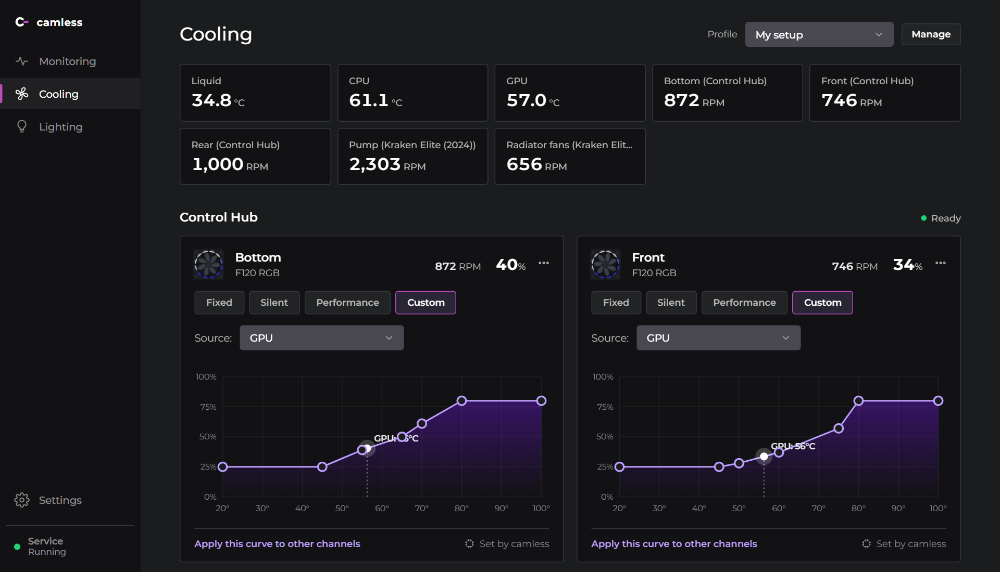
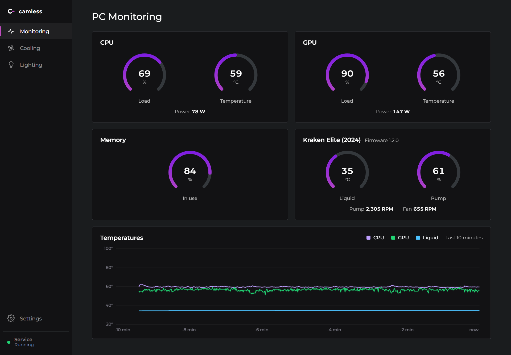
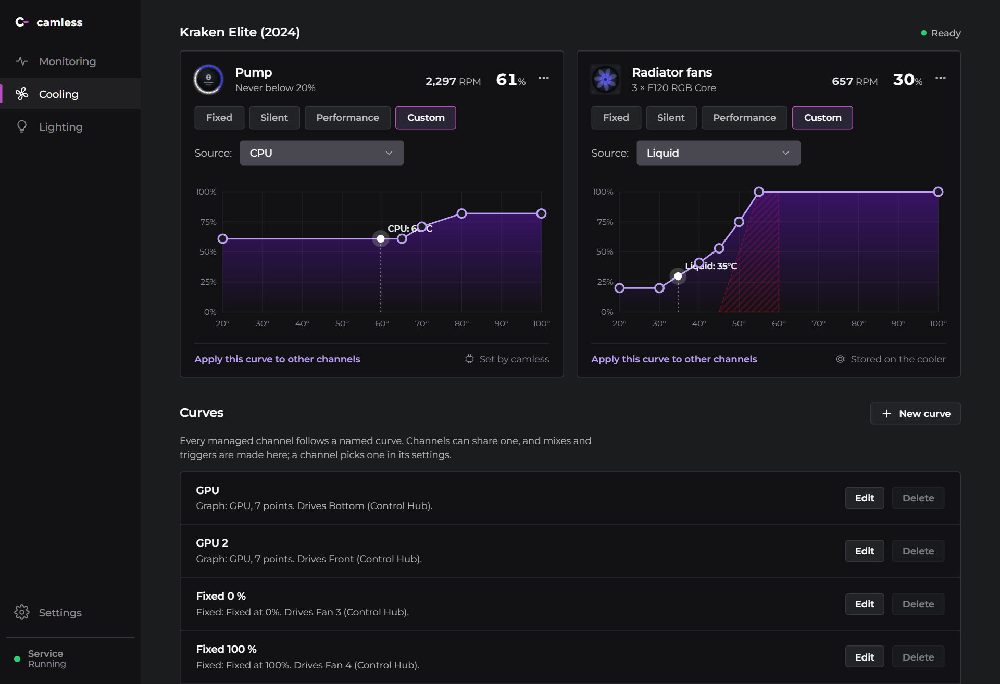
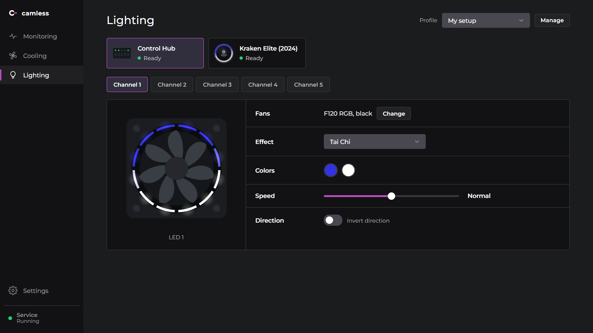
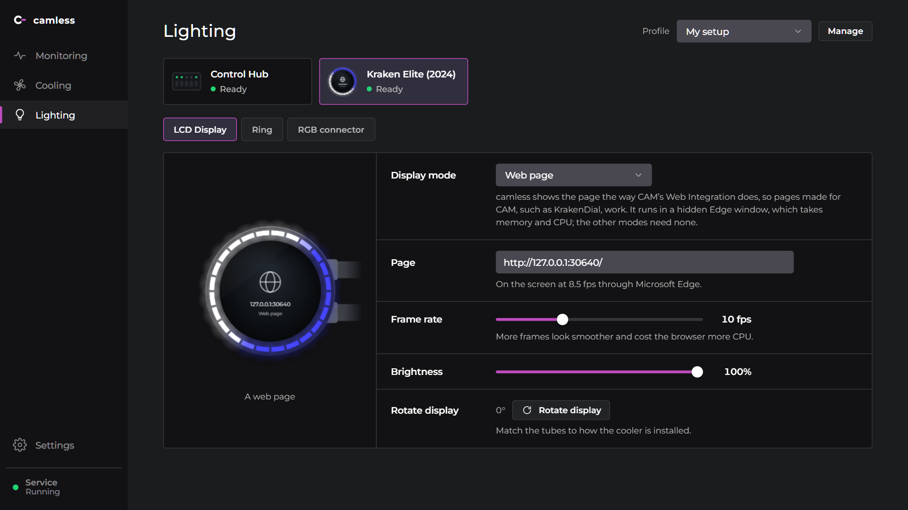

# camless

A light replacement for NZXT CAM. It handles fan and pump curves, lighting and the Kraken LCD in two small exes, about 4 MB together, where CAM installs about 500 MB of Electron.



**[Download camless-setup.exe](https://github.com/kleju13/camless/releases/latest/download/camless-setup.exe)** · Windows 10 and 11, x64 · [Linux](#linux), x64, not yet run on hardware

- **Curves as in FanControl.** A curve is a graph, a fixed duty, a mix of other curves or a trigger. It follows CPU, GPU or liquid temperature, load or power, with hysteresis and separate rise and fall times. Each fan adds its own offset and limits.
- **Curves stored on the Kraken.** When the Kraken can run a curve by itself, camless stores it there, so the pump keeps its curve if camless stops.
- **Lighting.** CAM's effects on the Kraken ring and on fans behind a Control Hub.
- **The Kraken LCD.** Liquid temperature, frames from your own program, or a web page made for CAM, such as [KrakenDial](https://github.com/kleju13/krakendial).
- **History.** Liquid temperature, CPU and GPU temperatures, loads, power and fan speeds over the last 10 minutes up to 30 days, a chart for each.
- **Games and FPS**, experimental and off until you turn it on. A card for each game, with its cover from Steam's cache on your PC. Every session with its play time, average frame rate, 1 % low and temperatures, and charts of its frame rate and temperatures. Steam, Epic and Xbox games are found on their own.
- **AI assistants.** `camless mcp` lets Claude or another MCP client read the sensors and set fan curves. A curve it sets must still speed the fans up when it gets hot.
- **Profiles.** Each one is a whole setup. *Import from NZXT CAM* makes one from what CAM is set to.
- **A tray app.** It updates itself from GitHub releases. Closing it never stops fan control.

| Monitoring | Kraken curves |
|---|---|
|  |  |
| **Lighting** | **LCD** |
|  |  |

> [!WARNING]
> camless sets your pump and fan speeds, and a bad curve can overheat your hardware. It comes with no warranty (sections 15 and 16 of the [license](LICENSE)). Two safeguards hold whatever the config says. While camless runs, liquid at 55 °C or above sends every fan and pump it manages to 100 %. The curve stored on a Kraken reaches 100 % at 55 °C liquid even when camless is not running. [How it works](docs/how-it-works.md#fan-control) has the details.

camless is not affiliated with or endorsed by NZXT. NZXT, CAM and Kraken are trademarks of NZXT, Inc.

## Devices

| Device | USB id | Tested on the maintainer's hardware, on Windows |
|---|---|---|
| Kraken Elite 2024 (Kraken Elite V2) | `1e71:3012` | pump and fan curves, lighting, LCD |
| Control Hub (H9 Flow RGB+ and other recent cases) | `1e71:2022` | fan duties, lighting |

These follow liquidctl, the Linux driver and Nexus, and nobody has run camless on them yet:

| Device | USB id | What camless drives |
|---|---|---|
| Kraken Plus 2024 | `1e71:3014` | pump and fan curves, lighting the cooler reports, LCD at the size it reports |
| Kraken Elite 2023 | `1e71:300c` | pump and fan curves; LCD from firmware 2 |
| Kraken 2023 (Kraken Base) | `1e71:300e` | pump and fan curves; LCD on firmware 2 |
| Kraken Z3 (Z53, Z63, Z73) | `1e71:3008` | pump and fan curves, RGB header; the LCD shows only its own display |
| Kraken X3 (X53, X63, X73) | `1e71:2007`, `1e71:2014` | pump curve, pump ring, logo and RGB header |

Experimental: Nexus leaves these out, so the driver follows liquidctl alone, and the app marks them *Experimental*:

| Device | USB id | What camless drives |
|---|---|---|
| Kraken X2 (X42, X52, X62, X72) | `1e71:170e` | pump and fan curves from firmware 3, pump ring and logo |
| Kraken M22 | `1e71:1715` | pump ring and logo |
| Kraken X31, X41, X61 (and X40, X60) | `2433:b200` | pump and fan duties, logo; on Windows, needs WinUSB bound to it with [Zadig](https://zadig.akeo.ie) |

Other brands' fan hubs and LED controllers, off unless you turn on *Settings → Devices → Other brands*: camless never drives keyboards or mice, and leaves a hub alone while its brand's app runs ([how it works](docs/how-it-works.md#other-brands)). None of them has run with camless yet, so the app calls them experimental. Their lighting is off or one colour:

| Device | USB id | What camless drives |
|---|---|---|
| Lian Li Uni Hub, SL, AL, SL-Infinity, SL v2, AL v2 | `0cf2:7750`, `0cf2:a100` to `a106` | fan duties and speeds on the four ports, and each port's lighting |
| Lian Li Uni Fan TL controller | `0416:7372` | each TL fan's duty and speed, and each port's lighting |
| Lian Li Strimer Plus V2 | `0cf2:a200` | the 24-pin and 8-pin cables' lighting |
| Asiahorse Umbra V2 | `1a86:fe04` | one duty for all its fans, and one colour on its ten ARGB ports |
| Nollie controllers, 1 to 32 channels | 16 models under `3061`, `16d2` and `16d5` ([list](docs/protocol.md)) | each channel's lighting |
| Corsair iCUE LINK System Hub | `1b1c:0c3f` | duties and speeds of the LINK fans and pumps, their temperature probes, and each device's lighting |
| HYTE Smart Hub | `3402:0904` | duties and speeds on the four fan headers, and the four ARGB ports |
| HYTE Nexus Portal NP50 | `3402:0901` | the FP12 fans and the 4-pin header, and the lighting of each module and the logo |
| iBUYPOWER MiniHub | `3402:0900` | duties and speeds on the two fan ports, and the four ARGB ports |

On Linux, camless also sets the motherboard's fan headers, experimental and off unless you turn on *Settings → Devices → Motherboard fans*: a CPU fan, case fans, or the pump of an AIO without software on a header. The BIOS keeps every header no curve takes, and gets each one back when camless stops ([how it works](docs/how-it-works.md#motherboard-fans)). Windows needs the fan chip's registers, which camless does not drive yet.

[hardware/verified.toml](hardware/verified.toml) lists the hardware camless was reported working on. With any other device camless drives, the app shows *Unverified hardware* in the sidebar, or *Experimental hardware* for the devices above. *It works* or *Something is wrong* there opens a GitHub issue with a hardware report filled in. Once you submit it there, *I submitted it* hides the prompt for that setup, and a works report adds the device to the list.

The app lists other NZXT devices as "no driver yet". If you have one, *Settings → Devices → Create report* opens a GitHub issue with what a driver needs filled in, and shows you all of it first. A driver is one Rust file, and [CONTRIBUTING.md](CONTRIBUTING.md) shows how to write one.

## Install

### Windows

1. Quit NZXT CAM, and turn it off in *Task Manager → Startup apps* so it does not come back at the next logon. While CAM's app runs, it holds the devices and camless cannot open them. CAM Service can keep running.
2. Run [camless-setup.exe](https://github.com/kleju13/camless/releases/latest/download/camless-setup.exe). It needs no administrator rights. It is not code-signed, so SmartScreen may stop it: *More info → Run anyway*. Or install from PowerShell, which also checks the download's SHA-256:
   ```
   irm https://raw.githubusercontent.com/kleju13/camless/main/scripts/install.ps1 | iex
   ```
3. The setup adds camless to the Start menu and opens it. The app starts the service and asks Windows for administrator rights. Answer Yes, so the service can read CPU temperature. To be asked only once, turn on *Settings → Service → Start as administrator without asking*.
4. To bring over your CAM setup, use *Profiles → Import from NZXT CAM*.

The app checks for a new release each time it starts and shows *Update available* under the service in the sidebar. *Update* there, or in *Settings → About*, installs it. Uninstall camless from *Settings → Apps* in Windows. It keeps your settings in `%APPDATA%\camless` unless you choose to delete them.

CPU temperature on AMD Zen also needs [PawnIO](https://pawnio.eu) and its signed `AMDFamily17.bin` in `%LOCALAPPDATA%\Programs\camless`. Without them, curves on CPU temperature hold the failsafe duty. The Kraken's liquid temperature needs none of this, so new curves use it by default.

### Linux

> [!NOTE]
> camless on Linux has not run on NZXT hardware yet. It has the same drivers as on Windows and reaches the devices through hidraw and usbfs, as liquidctl and Nexus do on Linux. Only the build, the install and the app with simulated devices were tested. *It works* or *Something is wrong* in the app tells us how it went.

It runs on x64 with glibc 2.34 or later and WebKitGTK 4.1: Ubuntu 22.04, Debian 12 and later.

1. Download `camless-linux-x86_64.tar.gz` and its `.sha256` from the [releases](https://github.com/kleju13/camless/releases). The first ones with it are betas. Then:
   ```
   sha256sum -c camless-linux-x86_64.tar.gz.sha256
   tar -xzf camless-linux-x86_64.tar.gz
   ./camless/install.sh
   ```
2. `install.sh` puts `camless` and `camless-gui` in `~/.local/bin`, adds camless to your desktop's menu, and runs the service as a systemd user service that starts when you log in. It also installs udev rules, `/etc/udev/rules.d/71-camless.rules`. They let whoever is logged in at the computer open the devices camless drives, and no others. `72-camless-fans.rules` gives you the motherboard's fan headers, for *Motherboard fans*. They are the only part that needs root, so sudo asks for your password. If camless cannot open a device right after, plug it in again or restart.
3. The app needs WebKitGTK 4.1 and GTK 3 (`libwebkit2gtk-4.1-0` on Debian and Ubuntu), and curl for updates. Its tray icon needs `libayatana-appindicator3-1` (or `libappindicator3-1`) and a desktop that shows such icons: KDE Plasma does, and GNOME with the AppIndicator extension. Without one, closing the window quits the app, and the service keeps running.

What is different from Windows:
- **No frame rates**, which come from Windows' ETW. Games finds Steam games, native and under Proton. camless does not ask which window is in front (Wayland does not say), so a game counts as played while it runs.
- **CPU temperature** comes from hwmon (k10temp, zenpower or coretemp) and needs no PawnIO. CPU power comes from RAPL, which only root can read, so it has no reading.
- **No admin rights**: the service runs as you. *Import from NZXT CAM* is on Windows only, like CAM, and so are firmware updates, which camless never installs: CAM on Windows does.
- **Kernel drivers** such as `nzxt-kraken3` can stay loaded. Do not run another program that sets the same fans, such as CoolerControl, liquidctl or fancontrol. camless leaves the motherboard's headers alone while CoolerControl runs, but does not see fancontrol.
- **Updates** download the new tarball and run its `install.sh`. When the udev rules have changed, the desktop asks for your password (pkexec), or you run `install.sh` from the download.

To uninstall, run `~/.local/share/camless/uninstall.sh`. It keeps your settings in `~/.config/camless`.

## Documentation

- [Configuration](docs/config.md): `camless.toml`, profiles, curve kinds and the command line.
- [How it works](docs/how-it-works.md): the service and the app, fan control and safeguards, history and games, AI assistants, web pages on the LCD, the local API, updates, and Linux.
- [Protocol notes](docs/protocol.md) for each device.
- [Contributing](CONTRIBUTING.md): building, testing and adding a device.

## Not done yet

- Drivers for other NZXT devices: the Smart Device V2 and the RGB & Fan Controller.
- On Linux: frame rates, and a run on real hardware.
- Other brands: Lian Li's wireless controllers, lighting effects on their hubs, and a run on real hardware.

## Credits

Most of what camless knows about NZXT devices comes from [liquidctl](https://github.com/liquidctl/liquidctl): its drivers, issues and pull requests. The Linux `nzxt-kraken3` driver helped too, and so did Nexus for the Krakens camless has not run on. Frames for the Kraken LCD are [Q565](https://github.com/seritools/q565), by seritools. How CAM streams them to the Kraken Elite was worked out from captures of CAM. The [protocol notes](docs/protocol.md) list the sources for each device. The history, the game sessions, the FPS counter and the MCP server were inspired by [Nexus](https://github.com/hello-nexus/nexus), which counts frames the same way.

## License

Copyright (C) 2026 kleju13 and camless contributors.

[GNU AGPL v3](LICENSE). Use it, change it and share it freely, at work too. If you pass on a changed version, or run one for other people over a network, you must publish its source under the same license.

The Montserrat font in `gui/ui` is under the [SIL Open Font License](gui/ui/OFL.txt).
