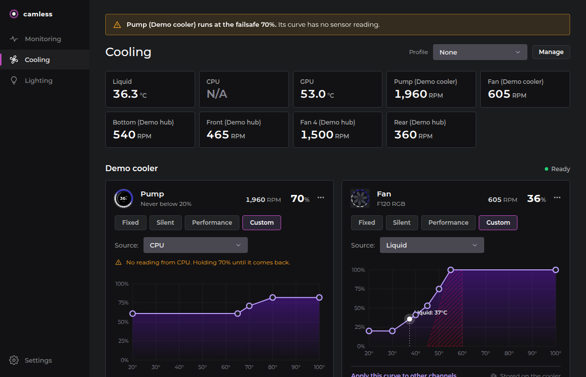

# camless

A light replacement for NZXT CAM: fan and pump curves, lighting and the Kraken LCD, without CAM's 1 GB of Electron.

- **`camless.exe`** is the service. It finds NZXT devices, runs the curves, sets lighting and drives the LCD. About 1.8 MB.
- **`camless-gui.exe`** is the app. It has a dashboard, a curve editor, lighting and LCD settings, and profiles. It edits `camless.toml`, and the service applies every change within a second. It lives in the tray: closing its window keeps it there, and *Exit* in the tray menu quits it. Closing the app never stops fan control.

camless-gui.exe is the one thing to launch: it starts the service if it is not running, asking Windows for administrator rights (UAC) so CPU temperature works. If the answer is no, the service runs without them and the app says so. The bottom of the sidebar always shows the service's state with a start or restart button, and *Settings → Service* starts, restarts and stops it.

Curves work as in FanControl, with an interface closer to CAM:
- curves are named objects: a graph on any sensor, a fixed duty, a mix of other curves (max, min, average, sum), or a trigger with separate load and idle thresholds;
- each graph has hysteresis and separate rise and fall times;
- each fan picks a curve and adds its own offset, minimum, maximum and ramp limits.



Not affiliated with or endorsed by NZXT. NZXT, CAM and Kraken are trademarks of NZXT, Inc.

**camless sets your pump and fan speeds, and a bad curve can overheat your hardware.** It comes with no warranty (sections 15 and 16 of the [license](LICENSE)): use it at your own risk. Two safeguards hold whatever the config says. While camless runs, liquid at 55 °C or above sends every managed fan and pump to 100 %. The curve stored on a Kraken reaches 100 % at 55 °C liquid, even when camless is not running. See [How the control works](#how-the-control-works).

## Status

| Device | USB id | Driver | Verified on hardware |
|---|---|---|---|
| Kraken Elite 2024 (Kraken Elite V2) | `1e71:3012` | `kraken-elite-v2` | pump and fan curves, lighting, LCD streaming |
| Control Hub (H9 Flow RGB+ and other recent cases) | `1e71:2022` | `control-hub` | fan duties, lighting |

Other NZXT devices show up in the app as "no driver yet". A driver is one file; see [CONTRIBUTING.md](CONTRIBUTING.md).

> Version 0.2 rewrote the service around device drivers and added the app. It runs on the maintainer's Kraken Elite 2024 and Control Hub: curves stored on the cooler and driven from the host, lighting, and LCD brightness and rotation. Web pages on the LCD have so far run against simulated devices (`camless run --demo`) only.

## Install

Download [camless-setup.exe](https://github.com/kleju13/camless/releases/latest/download/camless-setup.exe) from the [latest release](https://github.com/kleju13/camless/releases/latest) and run it. It installs both exes for your Windows user in `%LOCALAPPDATA%\Programs\camless`, without administrator rights, and adds camless to the Start menu and to *Settings → Apps*, where it uninstalls. The setup is not code-signed, so SmartScreen may stop it: *More info → Run anyway*.

Or in PowerShell, which checks the download's SHA-256 and installs silently:

```
irm https://raw.githubusercontent.com/kleju13/camless/main/scripts/install.ps1 | iex
```

The app asks GitHub for the latest release once each time it starts. When there is a newer one, *Update available* shows under the service in the sidebar, and *Settings → About* has *Update*. That downloads the setup, checks its SHA-256 and runs it. The setup closes the app, stops the service, replaces both exes and opens the app, which starts the service again. Running the setup or the install command again does the same.

Uninstalling asks whether to delete your settings and profiles in `%APPDATA%\camless`; by default they stay.

## Getting started

1. Quit NZXT CAM and stop its CAM Service. It holds the devices exclusively.
2. [Install](#install) camless. The setup opens it at the end; after that, it is *camless* in the Start menu.
3. Answer Yes when Windows asks for administrator rights. The app starts the service; `camless run` does the same from a terminal.
4. Optionally bring over what CAM is set to: *Profiles → Import from NZXT CAM* in the app, or `camless import-cam -o %APPDATA%\camless\camless.toml`.

To try the app without hardware, run `camless run --demo`. It uses a simulated cooler and hub and touches no USB device.

CPU temperature on AMD Zen needs [PawnIO](https://pawnio.eu), its signed `AMDFamily17.bin` next to `camless.exe` (in `%LOCALAPPDATA%\Programs\camless` once installed), and administrator rights. Without them, curves on `cpu.temp` hold the failsafe duty. The cooler's liquid temperature works without any of this, so it is the default sensor for new curves.

## Commands

```
camless status               open every supported device and print its channels, sensors and readings
camless list                 NZXT HID devices that are connected
camless watch [seconds]      listen to input reports without sending anything (--raw for hex)
camless sensors              read CPU, GPU and memory sensors once
camless import-cam [dir]     print a camless.toml built from CAM's active profiles (-o FILE to write it)
camless check [config]       validate a config and show what each fan follows, without opening a device
camless run [config]         apply the config and keep fans on their curves (--verbose, --demo, --for SECONDS)
camless lcd liquid           put the LCD's own liquid temperature screen back
camless lcd test [seconds]   stream a test pattern to the LCD (default 20 s)
camless lcd page URL         render a web page as the LCD would show it and save it as a PNG (-o FILE, --for SECONDS)
```

The config is `camless.toml` next to `camless.exe` if there is one, else `%APPDATA%\camless\camless.toml`.

## Profiles

A profile is a whole setup: curves, fans, lighting and the LCD. Each one is `profiles/<name>.toml` next to `camless.toml`, which then holds only the service settings and the profile it runs:

```toml
interval_ms = 1000
failsafe_duty = 70
profile = "NZXT CAM"          # profiles/NZXT CAM.toml
```

The app switches, creates, copies, renames and deletes profiles, and *Import from NZXT CAM* makes one from what CAM is set to, so there is always a way back. A setup can also live in `camless.toml` itself, without a profile, as in the example below; the app offers to save it as a profile before switching away from it. Fans that a profile leaves out keep the duty they were last given.

## Config

The app writes this file; editing it by hand works too. Device ids and channel names come from `camless status`.

```toml
interval_ms = 1000
failsafe_duty = 70            # fans whose sensor has no reading, and host-driven fans when camless stops

[[curve]]
kind = "graph"
name = "Liquid"
sensor = "kraken-elite-v2.liquid"
points = [[25, 25], [35, 40], [45, 80], [50, 100]]

[[curve]]
kind = "graph"
name = "GPU"
sensor = "gpu.temp"           # also cpu.temp, cpu.load, cpu.power, gpu.load, gpu.power, ram.load
points = [[45, 25], [80, 80]]
hysteresis = 2                # the sensor must move this far before the duty changes
response_up = 2               # seconds; how fast the curve follows a rise
response_down = 10            # and a fall

[[curve]]
kind = "mix"
name = "Case"
curves = ["Liquid", "GPU"]
function = "max"              # max | min | average | sum

[[curve]]
kind = "trigger"
name = "Boost"
sensor = "gpu.temp"
idle_duty = 30
load_duty = 70
load_at = 65                  # load_duty from here
idle_at = 55                  # back to idle_duty only below this

[[curve]]
kind = "fixed"
name = "Full"
duty = 100

[[fan]]
channel = "kraken-elite-v2/pump"
curve = "Liquid"
min = 40

[[fan]]
channel = "control-hub/fan1"
name = "Bottom"
curve = "Case"
offset = 5
step_down = 5                 # % per second at most

[[light]]
channel = "kraken-elite-v2/ring"
mode = "tai-chi"              # off | fixed | fading | spectrum-wave | covering-marquee | pulse | breathing
colors = ["3232de", "ffffff"] # candle | rainbow-flow | super-rainbow | rainbow-pulse | tai-chi | water-cooler
speed = "normal"              # slowest | slower | normal | faster | fastest

[[lcd]]
device = "kraken-elite-v2"
mode = "web"                  # liquid | frames (POST /v1/lcd/frame) | web
url = "http://127.0.0.1:30640/"  # web: shown with ?kraken=1, as CAM does
fps = 10                      # web: at most this many frames per second
brightness = 100
orientation = 0
```

`camless import-cam` builds this from CAM's files in `%APPDATA%\NZXT CAM\DataStorage\latest\user`: the active profile's curves (identical ones shared), fan nicknames, lighting and the LCD mode.

## How the control works

- **Curves a device can run by itself are stored on it.** This means a fixed duty, or a graph on the device's own sensor (a Kraken's liquid temperature). The Kraken keeps running them if camless stops. The fan's offset and limits are folded in. Smoothing and hysteresis are host-only.
- **Everything else is host-driven.** camless reads sensors every `interval_ms`, runs the curve engine, and sends duties that changed. Unchanged duties are re-sent once a minute.
- **Safety floor.** Every table stored on a Kraken, including the flat ones for host-driven duties, is raised to at least a ramp from 0 % at 45 °C liquid to 100 % at 55 °C. If camless hangs, the cooler still speeds up on its own.
- **Liquid at 55 °C or above** on any device sends every managed fan and pump to 100 %.
- **Missing sensor:** the fans on that curve hold `failsafe_duty`, and the app marks them.
- **Config changes** apply within one interval. Only what changed is sent again: lighting effects do not restart when a curve moves. An invalid file is reported in the app, and the previous config keeps running.
- **On exit:** host-driven fans go to `failsafe_duty` or their fixed duty, and LCDs go back to their own screen.
- **Lost devices** (sleep, resume, replug) are reopened every 5 s.

## Web pages on the LCD

`mode = "web"` shows a page the way CAM's Web Integration does, so pages made for CAM, such as [KrakenDial](https://github.com/kleju13/krakendial), work unchanged:
- a headless Microsoft Edge (or Chrome, if there is no Edge) renders it at the screen's size, 640×640 on a Kraken Elite;
- the URL gets `?kraken=1`, which tells a page it is on the cooler;
- `window.nzxt.v1` has `width`, `height`, `shape` and `targetFps`, and `window.nzxt.v1.onMonitoringDataUpdate` gets CAM's monitoring object every second;
- what the page draws goes to the screen at up to `fps` frames per second, and a page that stops changing is sent again every second.

The browser runs as the signed-in user even when camless runs as administrator, with its own profile in `%LOCALAPPDATA%\camless\browser`, and it ends with camless. If the page does not load, the screen shows liquid temperature and camless tries again every 10 s. `camless lcd page URL` renders a page once, without a device, to check it.

A browser is the heavy part of camless: KrakenDial with a video background takes Edge about 380 MB of memory and a fifth of a CPU core. The other LCD modes need no browser.

## Local API

| | |
|---|---|
| `GET /v1/status` | devices, channels, sensors, curves and duties, as `camless_core::status::Status`; the app reads this |
| `GET /v1/monitoring` | CAM's Web Integration monitoring object (`cpus`, `gpus`, `kraken`, `ram`); pages in web mode get the same through `window.nzxt.v1` |
| `POST /v1/stop` | stops the service the way Ctrl+C does: host-driven fans to the failsafe duty, the LCD back to its own screen; `Content-Type: application/json` only, so web pages cannot send it |
| `POST /v1/lcd/frame` | one frame for the LCD in `frames` mode at its size (640×640 on the Kraken Elite), raw RGBA or RGB565 big-endian, `Content-Type: application/octet-stream`; 202, 409 without such an LCD, 429 when two frames are already waiting |

It listens on `127.0.0.1:30641` by default and binds to loopback only. It rejects foreign `Host` headers, so web pages cannot reach it through DNS rebinding.

## Building

```
cargo build --release --workspace             # camless.exe and camless-gui.exe in target/release
cargo test --workspace --release
.\scripts\package.ps1                         # both, packed into dist\camless-setup.exe; needs Inno Setup 6
camless run --demo demo.toml                  # simulated devices, for working on the app
camless-gui --serve 127.0.0.1:30652 --config demo.toml --ui-dir gui/ui   # the app's page in a browser
```

CI builds the setup for every pull request; it is the run's *camless-setup* artifact. A tag `vX.Y.Z` that matches the version in all three `Cargo.toml` files publishes it as a release.

The workspace has three crates:
- `camless`: the service, drivers and CLI;
- `core`: config, curve engine and status types, with no hardware code;
- `gui`: the app, a tray icon and a WebView2 window; the page itself is in `gui/ui`. Its icon, `gui/camless.ico`, is built into both exes; `tools/icon/make_icon.py` redraws it.

The protocol details are in [docs/protocol.md](docs/protocol.md).

## Not done yet

- Starting the service at logon without a UAC prompt. *Start with Windows* starts the app, which asks for administrator rights each time.- Drivers for other NZXT devices.

## License

Copyright (C) 2026 kleju13 and camless contributors.

[GNU AGPL v3](LICENSE). Use it, change it and share it freely, at work too. If you pass on a changed version, or run one for other people over a network, you must publish its source under the same license.

The Montserrat font in `gui/ui` is under the [SIL Open Font License](gui/ui/OFL.txt).
